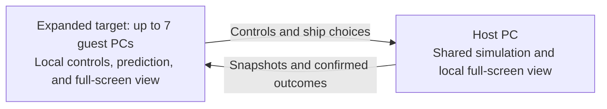

# ADR 0001: Player-hosted LAN versus multiplayer

Status: Accepted gameplay design. Browser connection and synchronized setup are locally verified; networked gameplay is not implemented.
Date: 2026-11-08
Updated: 2026-11-13 for post-host pilot/vehicle/hue selection and joining during play.
Current session design: [Hosted setup and live joining](../plans/hosted-multiplayer-session.md).
Approval: The user confirmed the design and approved this document and the project glossary at Q14.
Related terms: [Project glossary](../../GLOSSARY.md).
Current transport plan: [Browser-hosted WebRTC multiplayer](../plans/browser-webrtc-multiplayer.md).
Historical proposal: [RFL-derived C TCP multiplayer](../plans/lan-tcp-multiplayer.md).

## Context

Starship needs multiplayer with one player per computer and a full-screen local view.
The original native-port design now targets browser-hosted WebRTC first, using the C/WASM engine.
The first milestone networks an existing versus stage. Campaign co-op is also a selectable target; its engine integration follows the first working versus match.

The initial connection flow must work over a wired LAN, ordinary home Wi-Fi, or a user-managed Tailscale network.
One player hosts while playing. Linux and Windows peers must be able to play together.

The existing versus simulation already has four player slots, but networking cannot be added by changing a viewport setting.
Player allocation, player updates, cameras, and viewport drawing currently share `gCamCount`.
Some rendering functions also change gameplay state.
The existing Wolfen mod replaces Arwing resources, so mixed ship choices need both resource sets available at once.

## Decision

Use a playing host that owns the authoritative shared simulation.
Guests send their controls and ship choices to the host.
The host decides damage, pickups, deaths, respawns, scores, and match outcomes.

Guests predict their own movement for immediate control response.
Host snapshots correct that prediction, and guests interpolate remote movement between received updates.
The host also renders its own full-screen local view.

Separate simulation participation from local presentation.
Each PC renders one participant's camera and HUD without removing the other players from the shared world.
Gameplay decisions must not depend on which local camera is drawn.

### Approved player experience

| Area | Behavior |
| --- | --- |
| Capacity | First deliver the two-to-four-player Corneria proof, then eight players in two teams of four, including the host. Design new player state for eight from the start. One player per PC. |
| View | One full-screen local camera and HUD. No split screen. |
| Platforms | Linux and Windows peers can share a session. |
| Joining | Open the reachable signaling service and enter the host's room code. Browser WebRTC carries game traffic to the playing host. |
| Lobby and live joining | The host can start alone. Other players may join during play after choosing a pilot and synchronizing with the current world. |
| First milestone | Corneria with a Points match. |
| Required pilots | Fox, Falco, Slippy, Peppy, Pigma, Katt, and Vitzy, alongside the existing replacement crew. Vitzy is a Katt-derived axolotl. |
| Expanded arena | Venom showdown as a separate versus entry. |
| Aircraft roster | Arwing, Wolfen, Katt's original fighter, and Vitzy's separate magenta-and-pink Bill-derived fighter. PvP keeps free pilot and ship selection. Co-op uses crew-appropriate pilot assignments. |
| Ship behavior | Identical handling, weapons, health, and collision size. Only models and engine and laser colors differ. |
| Pilot changes | Select a pilot before that participant first spawns. Keep the pilot for the remainder of the match. |
| Duplicate pilots | Allowed. Every additional instance of the same pilot gets a distinct portrait, ship-marker, and laser hue. |
| Respawns | Offer vehicle selection after every death, keeping the same pilot. Initially Arwing or Wolfen, with tank and on-foot choices added later. |
| Team rules | Respawning team-points combat. Competitive teams may use any pilot and available aircraft. Co-op uses one crew with matching aircraft and Katt's and Vitzy's signature-fighter exceptions. |
| Additional AI | A third hostile faction attacks both human teams. AI enemies are separate from the eight human slots. AI kills do not advance the victory score. Population budgets need validation. |
| Friendly fire | Selectable and off by default. Lock-on always ignores teammates. A friendly-fire kill subtracts one team point. |
| Guest timeout | Remove the timed-out guest's ship. Do not pause or end gameplay for the remaining players. |
| One remaining player | Gameplay continues even if only the host remains. A guest timeout does not force a lobby transition. |
| Host departure | End the session. There is no transfer of hosting in this milestone. |
| Menus | Opening a menu does not pause the network match. |

The user amended the earlier lobby-only rule on 2026-11-13.
Room-code joining stays available while the host plays.
A new or returning guest chooses a pilot, starting vehicle, and preferred hue, then loads and acknowledges the current world before the host activates its ship.
The host keeps simulating during this process. Match identity, stage epoch, peer incarnation, and spawn generation reject obsolete admission or input.
The setup preview implements choices and late setup synchronization; running-game admission still needs the C/WASM world bridge.

### Connection scope

The browser connection proof uses a reachable signaling service and a room code.
The original native proposal used the host's direct address.
LAN and Tailscale browser paths still require real ICE connection tests.
Tailscale supplies network connectivity between the PCs. It does not replace the game's host or shared simulation.
Users manage their own Tailscale installation, access rules, and connectivity.

Tailscale can use a direct or relayed connection. Relayed connections can have higher latency.
Connectivity alone does not establish that a connection feels acceptable for combat.
See [Connect to devices](https://tailscale.com/docs/how-to/connect-to-devices) and
[Tailscale connection types](https://tailscale.com/docs/reference/connection-types).

Automatic LAN discovery, a public server list, and account services are outside the first milestone.
The browser direction adds signaling and optional externally configured STUN/TURN services.
A dedicated game-simulation server remains outside this decision.

### Ship selection and vehicle forms

Keep ship variant separate from vehicle form.
Arwing and Wolfen initially share aircraft gameplay while selecting different visuals.
A Wolfen choice must not globally replace the Arwing seen by another player.
Replicate each player's ship choice so every PC displays the same selected variant and associated colors.

Offer the available ship choices before the initial spawn and after death.
The original respawn code already contains a vehicle-choice flow, but it also contains paths that force Arwing.
The networked flow must preserve the opportunity to choose between both initial variants.

Tanks and on-foot forms can later extend that selection.
Adding those forms does not require changing the meaning of ship variant.

## Crew selection and original asset preservation

Multiplayer must offer character selection from both the Star Fox crew and the Star Wolf crew.
Replacing the main cast must not remove access to the original Star Fox character assets.
Both crews must be available in the same running game, so different players can select characters from either roster.

Preserve original character resources under stable, separately addressable identities before applying replacements.
Keep the original resource archive intact. Retain access to the original models, textures, skeletons, animations, and portraits that multiplayer selection needs.
A replacement at an existing resource path must not become the only accessible version of that resource.
The asset builder and runtime resource lookup must support both versions together.

The current [character builder](../../tools/wolf_character.py) writes replacement resources for title, versus, and aircraft character presentation.
This path needs an audit for original-resource access before further replacement work relies on it.
This documentation change does not establish that preservation or runtime character selection is already implemented.

Replicate the selected character identity so all peers show the same character for each player.
Character choice adds no gameplay differences to the approved initial aircraft rules.
In competitive play, character and ship selection are independent. Fox can fly a Wolfen and Wolf can fly an Arwing.
Duplicate pilots are allowed, with distinct portrait, ship-marker, and laser hues for every additional selection of the same pilot.
The selected pilot stays fixed for the match. Vehicles can change after death.
Multiplayer team membership imposes no competitive pilot or ship restriction. Co-op selects one crew and its matching aircraft, including pilot-specific assignments.
Star Fox normally uses Arwing, with Katt using her own fighter. Star Wolf normally uses Wolfen, with Vitzy assigned her separate signature fighter.
Katt belongs to Star Fox. Vitzy the axolotl and Pigma belong to Star Wolf.

Verification must show original Star Fox and replacement Star Wolf characters together in one match.
Verify character and ship independence with both Fox in a Wolfen and Wolf in an Arwing.
Check the cockpit character, portraits, and other character displays for each selection.
Repeat the build to verify that originals remain available and replacements do not accumulate destructively.

## Required pilots and stable asset identities

The requested selectable pilots include Fox, Falco, Slippy, Peppy, Pigma, Katt, and Vitzy.
Vitzy is a Star Wolf axolotl derived from Katt, with a separate identity, appearance, and portraits.
This list does not remove the mod's existing replacement crew from the earlier crew-selection requirement.
The final roster is not limited to seven pilots.

Use distinct logical keys for the original Star Fox pilots so the current mod can keep its existing replacement paths.
The following naming convention is a design target, not an implemented registry:

| Display name | Logical pilot key | Asset requirement |
| --- | --- | --- |
| Fox | `fox_original` | Preserve the original Fox assets independently of the current replacement. |
| Falco | `falco_original` | Preserve the original Falco assets independently of the current replacement. |
| Slippy | `slippy_original` | Preserve the original Slippy assets independently of the current replacement. |
| Peppy | `peppy_original` | Preserve the original Peppy assets independently of the current replacement. |
| Pigma | `pigma` | Star Wolf. Audit the resources needed for cockpit, portraits, and later player forms. |
| Katt | `katt` | Star Fox. Retain an unmodified Katt source for both selection and derivation. |
| Vitzy | `vitzy` | Star Wolf axolotl derived from Katt. Keep Katt's original appearance intact. Her signature ship is a private magenta-and-pink Bill fighter variant. |

The proposed resource namespace is `pilots/<pilot-key>/<original-resource-path>`.
For example, the preserved Fox skeleton can have the identity
`pilots/fox_original/ast_title/aFoxSkel`.
Keep the legacy paths used by the current mod unchanged.
Do not globally rename existing Fox symbols, resource paths, or campaign character slots to restore the original cast.

Preserving a root resource alone is insufficient.
Copy or safely resolve its skeletons, limbs, display lists, vertices, textures, and animation dependencies under preserved identities.
Native resources contain hashed references. A renamed dependency needs its referring hashes updated too.
No preserved pilot dependency may silently resolve through an overridden legacy path.

On 2026-11-09, the existing title and on-foot export bundles for all four original Star Fox pilots
were checked byte-for-byte against `sf64.o2r` and against their manifests.
Those exports are available under `assets/characters/native/<pilot>/`.
They do not establish that cockpit and portrait sets are complete, or that the runtime can select the originals.
The [native resource extractor](../../tools/extract_team_bodies.py) records dependency relationships but exports resources using their original internal paths.

Verification must resolve the preserved pilots with the replacement mod loaded.
Original and replacement pilots must appear together without changing the mod's selected main cast.
Vitzy edits must leave Katt's original resources unchanged.
Repeat the resource build to check preservation and reference stability.

### Vitzy's fighter and crew affiliation

Katt belongs to Star Fox. Vitzy the axolotl belongs to Star Wolf. Pigma belongs to Star Wolf.
The original Fox, Falco, Slippy, and Peppy remain Star Fox, while the mod's existing replacement crew remains Star Wolf.

Vitzy is an axolotl pilot derived from Katt's assets, with a distinct identity, appearance, and portraits.
Derivation must leave the original Katt resources intact.

Vitzy's signature aircraft is a magenta-and-pink version of Bill's fighter.
Use the proposed logical ship key `vitzy_fighter`, with private resources under `ships/vitzy_fighter/`.
These are target identities, not implemented resource registrations.

The source selects `aBillShipDL` for `AI360_BILL` in [`fox_360.c`](../../src/engine/fox_360.c).
The resource path is `ast_allies/aBillShipDL`, declared in [`ast_allies.h`](../../include/assets/ast_allies.h).
Preserve Bill's original model, textures, and dependencies.
Vitzy's geometry or palette changes must not replace the original Bill fighter globally.
The complete dependency graph, cockpit pilot presentation, engine effects, and shadow need an audit for player-controlled use.

This is an additional aircraft appearance under the shared aircraft gameplay rules.
It does not introduce different handling, damage, health, or collision size.
The requested aircraft roster therefore includes Arwing, Wolfen, Katt's own fighter, and Vitzy's separate fighter.
The small Corneria proof can establish aircraft networking with Arwing and Wolfen before the additional appearance is integrated.

Keep competitive pilot and ship selection independent, including the new fighter.
In co-op, use crew-appropriate aircraft with pilot-specific assignments.
Star Fox pilots use Arwing. Star Wolf pilots normally use Wolfen.
Vitzy uses her signature Bill-derived fighter as the specific exception to that default.
The host still selects one crew for the co-op session.

Verification must show Vitzy with the magenta-and-pink fighter, Katt unchanged, and Bill's original ship unchanged in its existing uses.
Check the fighter in a mixed-pilot match and check that duplicate-pilot hue changes remain consistent with its base palette.

## Eight-player team battle and Venom showdown target

The desired expanded mode is four human players against four human players.
Eight includes the playing host. Each PC still presents one full-screen local view.
The earlier Corneria Points proof uses two to four players.
Deliver that Corneria proof first, followed by eight-player Venom. Design new networking and player-state interfaces for eight participants from the start.

Eight-player support is a gameplay-capacity change, not just a connection limit.
Separate network player slots from the four physical controller ports, the local camera, pilot identity, and multiplayer team membership.
The new capacity must cover player storage, input processing, projectile ownership, lock-on targets, HUD state, respawns, and scoring.
Wire formats and new player-state interfaces must accommodate eight players without depending on four-slot controller layouts.

A multiplayer team is a separate concept from campaign `TEAM_ID_*` ally identities.
Use a respawning team-points match with a shared team score. Friendly fire is selectable and defaults to off.
Competitive pilot and available-aircraft choices are unrestricted, duplicates are allowed, and pilot identity is fixed for the match.
The existing `VS_MATCH_BATTLE` is an elimination mode and does not supply these respawning team rules.

Add Venom showdown as a separate versus entry based on the all-range Venom 2 showdown layout.
The original campaign level and its progression remain separate.
Reuse the scenery and selected base geometry through a dedicated arena setup with collision, boundaries, and eight suitable spawn positions.
Do not run the campaign's cutscenes, NPC battle events, or completion/save triggers as multiplayer rules.

The campaign's Star Fox and Star Wolf actors do not provide eight existing human player slots.
Arena reuse still needs playable validation for visibility, collisions, spawn safety, and team balance.

### Settled team and selection rules

Deliver the two-to-four-player Corneria Points proof before the eight-player Venom team mode.
Design new networking and player-state interfaces for eight participants from the start.

In competitive play, either team may select any available pilot and aircraft variant.
Co-op is an explicit exception. The host selects one crew, players choose pilots from that crew, and aircraft must match the crew.
Star Fox co-op normally uses Arwing, with Katt using her own fighter. Star Wolf co-op normally uses Wolfen, with Vitzy using her separate signature fighter.
Katt is Star Fox and has her own fighter, identified by ast_allies/aKattShipDL. Vitzy and Pigma are Star Wolf. Vitzy keeps her separate Bill-derived fighter. Later added pilots will need explicit affiliations.
Crew-specific restrictions for later tank and on-foot forms are not settled by this aircraft rule.
Pilot identity is fixed for the duration of a match.
After death, players can change vehicles without changing pilots.
The initial aircraft milestone offers Arwing and Wolfen. Tanks and on-foot forms join that flow when those forms are added.

Duplicate pilots are allowed.
For every additional selection of any pilot, apply a distinct hue to that player's portrait, ship marker, and laser color.
For example, additional Fox selections receive different hues. The same rule applies to additional Katt, Pigma, and other pilot selections.
The hue changes presentation, not movement, weapons, damage, health, or collision.
Do not recolor the original source assets in place.
All peers must agree on the assigned appearance, and the appearance must remain stable through respawns.
Duplicate hue selection must coexist with the ship's normal laser palette and preserve readable team identification.

The four-on-four mode is a respawning team-points match.
Human opponent kills contribute to the shared team score. AI kills do not advance that score.
This differs from the existing elimination rules of `VS_MATCH_BATTLE`.

Friendly fire is a selectable match rule and defaults to off.
The host must enforce the selected damage rule.
Lock-on always ignores teammates, even when friendly fire is enabled.
Killing a teammate with friendly fire enabled subtracts one point from the responsible player's team score.

### Enemy population and player capacity

Competitive matches must include additional AI enemies alongside the two human teams.
These AI enemies do not occupy or replace any of the eight human player slots.
The AI forms a third faction hostile to both human teams. AI kills do not advance the victory score.
Enemy count and spawn behavior still need tuning and validation.
The host owns their simulation, damage, targeting, and replicated outcomes.

AI population is distinct from human player capacity.
The current [context declarations](../../include/sf64context.h) include `gActors[60]` and `gPlayerShots[16]`.
These are shared pools, not a statement that sixty enemies or sixteen projectiles are sufficient for the expanded mode.
Enemy density, spawn budgets, targeting capacity, and projectile availability need validation with eight humans and the additional AI active.
AI targeting must distinguish a human player slot from an NPC actor identity and support humans beyond player zero.
Campaign character target IDs must not be reused as interchangeable human slot IDs.
NPC projectile ownership also needs an explicit identity that cannot collide with human ownership.

Expanded verification must cover fixed pilot identity through respawns, vehicle changes,
duplicate-pilot portrait/marker/laser hues on every peer, shared team scoring,
friendly fire both off by default and enabled explicitly, and allied lock-on remaining disabled.
Test added AI targeting against human slots zero through seven and projectile availability while humans and AI fire together.
Verify that AI kills leave the victory score unchanged and that a friendly-fire kill subtracts exactly one team point.

### Source evidence for the expansion

These observations were checked in the working tree based on commit `d404e14d` on 2026-11-09.

| Source | Observation |
| --- | --- |
| [`sf64context.h`](../../include/sf64context.h) | Player scores and many other arrays have four entries. `gVsLockOnTimers` is four by four, and `gVsKills` is four by ten. |
| [`fox_versus.c`](../../src/engine/fox_versus.c) | `Versus_CheckForWinner` uses four-player loops and an individual winner. Team scoring requires explicit rules and representation. |
| [`fox_beam.c`](../../src/engine/fox_beam.c) | `PlayerShot_FindLockTarget` clears four target rows and excludes the shooter without a multiplayer teammate rule. Other projectile paths distinguish human shots using `sourceId < 4`. |
| [`sf64object.h`](../../include/sf64object.h) | Actor lock-on timers have four entries. Expansion must cover NPC targeting as well as player-to-player targeting. |
| [`fox_360.c`](../../src/engine/fox_360.c) | The human pursuit branch in the all-range AI uses `gPlayer[0]`. Other target identities resolve through NPC actors, so later human slots need a distinct target representation. |
| [`fox_enmy2.c`](../../src/engine/fox_enmy2.c) | `Actor_SetupPlayerShot` uses `actorId + NPC_SHOT_ID` for ownership. `Actor_SpawnPlayerLaser` searches only the first ten entries of the shared player-shot pool. |
| [`fox_ve2.c`](../../src/overlays/ovl_i6/fox_ve2.c) | `Venom2_LoadLevelObjects` loads scenery, actor objects, and a base boss separately. `Venom2_UpdateEvents` addresses player zero and scripted NPC actors. |
| [`fox_play.c`](../../src/engine/fox_play.c) | `Play_InitVsStage` selects existing versus layouts and provides a separate integration point for a new arena. |

Expanded verification needs eight simultaneous human-controlled instances, correct ownership for slots four through seven,
agreed team scoring and targeting, mixed original and replacement pilots, and a Venom VS match without campaign progression side effects.
The original Venom campaign mission and the mod's replacement cast also need regression checks.

## Source evidence and required separation

These observations were checked in the working tree based on commit `d404e14d`.
Links point to files. Symbol names identify the relevant code as line numbers change.

| Source | Observation and implication |
| --- | --- |
| [`fox_play.c`](../../src/engine/fox_play.c) | Level setup assigns `gCamCount = 4` for versus and allocates `gPlayer` using that value. Player and camera update loops also use `gCamCount`. Rendering one view must retain all simulation participants. |
| [`fox_game.c`](../../src/engine/fox_game.c) | `Game_Draw` and `Game_InitViewport` use `gCamCount` to draw multiple views. Local viewport selection needs a separate responsibility. |
| [`sys_joybus.c`](../../src/sys/sys_joybus.c) | `Controller_UpdateInput` derives press edges from held and previous input. Network input processing must preserve button transitions rather than treating every packet as a new press. |
| [`fox_display.c`](../../src/engine/fox_display.c) | `Display_Player_Update` clears versus lock-on timers based on view-space checks in its Landmaster path. The deferred tank form will need this behavior separated from drawing. |
| [`fox_edisplay.c`](../../src/engine/fox_edisplay.c) | `Actor_DrawAllRange` clears lock-on timers and can kill offscreen debris. Targeting and object lifetime need an audit before peers draw different local views. |
| [`fox_versus.c`](../../src/engine/fox_versus.c) | `Versus_UpdateTimer` consumes timestamps written by `Versus_Draw`. Later networked Time matches need a host simulation clock independent of drawing. |
| [`fox_versus.c`](../../src/engine/fox_versus.c) | `Versus_UpdatePlayerStatus` handles respawn choices and has a one-player special case. A guest timeout must not disable the remaining player's respawns. |
| [`build_wolfen.py`](../../tools/build_wolfen.py) | Wolfen construction redirects Arwing resources. Mixed variants need simultaneous resource availability and a per-player selection. |
| [`sys_math.c`](../../src/sys/sys_math.c) | `Rand_Init` uses wall-clock time. Sending identical inputs to each PC does not by itself establish identical simulation results. |
| [`sf64object.h`](../../include/sf64object.h) | Object state includes process-local pointers. Portable snapshots need explicit data fields rather than raw structure copies. |

The input, simulation, and presentation boundaries require source changes before this design can run.
This document records the intended behavior, not evidence that those changes already exist.

## Alternatives considered

### Exchange inputs and simulate the entire game independently on every PC

This approach can send little data and reuse much of the current simulation.
It requires the same results from the same inputs on every PC.
The current wall-clock RNG initialization and rendering side effects prevent assuming that property.
Linux and Windows consistency has not been demonstrated.
Choose host-owned state for this milestone rather than making full-game determinism a prerequisite.

### Make every guest wait for host movement updates

This avoids local prediction but adds network delay to the player's own controls.
That conflicts with the approved requirement for responsive Wi-Fi and Tailscale play.

### Stream one running game to remote screens

Streaming does not give each browser its own local simulation and full-screen game camera.
It also ties control response to video transport.
The target is a local C/WASM simulation and presentation on each participating PC.

### Start with a dedicated server or transfer hosting after departure

Both add lifecycle and deployment work beyond a match hosted by one player.
The approved session ends when the host leaves.

## Browser-hosted WebRTC direction

On 2026-11-12, the user selected a browser-hosted WebRTC approach.
The [browser plan](../plans/browser-webrtc-multiplayer.md) supersedes raw TCP as the first browser transport.
A small signaling service exchanges connection setup. Game messages travel through WebRTC data channels.
The first connection proof is separate from WASM gameplay integration and leaves the single-player preview intact.
The host-authoritative simulation, roster, respawn, and scoring rules above remain the contract.

## RFL reuse and TCP planning

The earlier native proposal was to reuse the C RFL networking as a starting point and adapt it to TCP.
The browser WebRTC plan supersedes that first transport choice.
The located source is `/home/amber/proj/rfl/rfl_net.c` with its `rfl_net.h` interface.
It opens a UDP `SOCK_DGRAM` socket. No separate C TCP implementation was verified in the checked RFL working copies.
Its current pose relay is not the authoritative control-and-combat protocol required here.

The [technical plan](../plans/lan-tcp-multiplayer.md) compares bounded main-thread polling with a dedicated I/O worker.
It proposes bounded nonblocking polling first, a domain-facing C session interface, explicit TCP framing and serialization,
per-peer backpressure, host-owned gameplay, and a verified prediction boundary.
The plan records the alternative, source fingerprints, and evidence required to reconsider the choice.
This is a planning artifact. It does not implement the transport or establish acceptable Wi-Fi or Tailscale responsiveness.

## Consequences and remaining engineering choices

The host has less network delay than guests.
Local prediction improves guest control response but cannot remove delayed hit confirmation.
Guests may see position corrections when their predictions differ from host state.

Networking must not block simulation while waiting for a guest.
Input loss must not leave a disconnected player firing indefinitely.
Timeout handling must preserve the remaining players' simulation and respawns.

The following details need implementation investigation and validation:

- The WASM worker bridge, final packet format, protocol compatibility rules, and complete snapshot contents described in the browser plan.
- Input and snapshot rates relative to the existing simulation cadence.
- Prediction, reconciliation, and interpolation behavior under delay and packet loss.
- Timeout duration and the treatment of stale controls before removal.
- Exact engine and laser palettes for the aircraft variants and duplicate-pilot appearances.
- Whether later internet play needs historical hit validation.

These details are not measured results or promises about acceptable latency.
A transport library alone does not provide entity replication, prediction, or the gameplay changes above.

## Evidence required for the first milestone

The following checks describe required proof. They have not been run as part of this documentation change.

| Scenario | Required observation |
| --- | --- |
| Two-player match | Host and guest join, ready up, start Corneria Points, fight, score, and complete a match. |
| Four-player match | Four instances participate with correct controls, cameras, ship identities, and scores. |
| Linux and Windows | A match works with either operating system hosting and the other joining. |
| Independent views | Each player sees its own full-screen camera and HUD. Remote players remain simulated and visible when in view. |
| Mixed ships | Arwing and Wolfen appear together with the correct engine and laser colors. Switching appearance does not change gameplay properties. |
| Respawn choice | A player dies, selects an eligible vehicle, and respawns as the same pilot. Every peer sees the new vehicle and unchanged pilot identity. |
| Duplicate pilot choices | Repeat Fox and other pilot selections. Additional selections get distinct portrait, ship-marker, and laser hues. Every peer sees the same assigned appearance before and after respawns. |
| Guest loss | A guest loses connectivity and times out while remaining players keep moving, firing, and scoring. |
| Host alone | After every guest times out, the host can continue playing and respawning without an automatic pause or lobby transition. |
| Host loss | Guests leave the session cleanly when the host exits or becomes unreachable. |
| Menus | One player opens a menu while the other players continue playing. |
| Network conditions | Actual Wi-Fi and Tailscale sessions are exercised. Delay and packet-loss checks record movement corrections and hit-confirmation behavior. |
| Presentation differences | Different local views and render frame rates do not change authoritative targeting, timers, or scores. |
| Offline regression | Existing offline play still works after network integration. |

Two local processes can establish basic message exchange.
They do not replace testing on separate Linux and Windows PCs or exercising actual Wi-Fi and Tailscale paths.

## Follow-on scope

The expanded goal includes eight-player four-on-four combat and a new Venom showdown versus entry.
Deliver the earlier two-to-four-player Corneria proof first, followed by the eight-player Venom team mode.
Also extend support to the existing versus stage and match-type combinations.
Add tanks and on-foot play after aircraft networking works.
Validate macOS separately later.

Campaign co-op is now an explicit main-game selection target. Its playable engine integration remains pending. Its selection rule is one crew with matching ships.
Katt is Star Fox, and Vitzy and Pigma are Star Wolf. Later vehicle-form restrictions and affiliations for future pilots still need definition.
Mission progression, checkpoints, death rules, cutscenes, and the role of AI teammates still need their own decisions.
Competitive reuse of the Venom layout does not implement campaign co-op.
