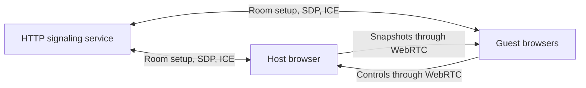

# Browser-hosted WebRTC multiplayer

Date: 2026-11-14
Status: Real C/WASM Corneria Points host/guest launch, world replication, live joining and the local single-player HUD are implemented. See [the bridge reference](../multiplayer-wasm-bridge.md) for current limits.
Latest flow: [Hosted setup and joining during play](hosted-multiplayer-session.md).
Direction: One browser hosts the authoritative match. Other browsers join it.
This replaces raw TCP as the first browser transport target.
The [earlier TCP plan](lan-tcp-multiplayer.md) remains a record of the native transport proposal.
The gameplay contract remains [ADR 0001](../adr/0001-lan-versus-multiplayer.md).

## First implemented boundary

The first milestone is a standalone connection proof under `tools/multiplayer/`.
It provides room creation, room-code joining, one WebRTC peer connection per guest,
and real data channels for numbered inputs and host snapshots.
It now includes actual radio-portrait selection, starting aircraft, preferred/assigned hues, and host-selected VS or main-game setup.
Late guests receive the current accepted choices.
The connection proof now also launches the WASM bridge and admits guests into a running Corneria Points world.

The Node service uses HTTP and server-sent events for signaling.
It owns room membership, opaque peer identities, connection tokens, setup-message routing, and bounded cleanup.
It does not own game simulation and does not route control samples or snapshots.
Static serving is restricted to the proof's browser files.

The browser session owns peer connections, data channels, setup-message ordering,
buffer limits, input sequence checks, snapshot freshness, and transport teardown.
The host binds incoming controls to the participant assigned to that peer.
A guest cannot publish authoritative host snapshots.

The proof uses binary UTF-8 JSON with versioned and validated input/snapshot shapes.
This is a connection-test codec, not a complete inventory of Starship's replicated state.
The final engine protocol must include match and spawn identities, authoritative own-player state,
entity generations, and input acknowledgments as established in the earlier design.

## Game ownership after integration

The existing WASM game worker remains the sole simulation writer.
A browser transport adapter passes validated protocol messages to that worker.
Networking callbacks must not mutate engine globals.

The WASM worktree at commit `63783904` already submits a packed atomic controller value through
`Wasm_SetControllerState` in `src/port/Game.cpp`.
`Wasm_ReadController` consumes that value for controller zero in `src/sys/sys_joybus.c`.
This is a local-input bridge, not a multiplayer API.
The next change needs per-participant numbered inputs, consumption at a simulation boundary,
and a consistent snapshot export from the game thread.
Map normalized network axes to the engine's controller range at that boundary.
The current `STARSHIP_GAME_STATE` diagnostics contain a small local-player sample, not enough state to replicate a match.

The host browser runs player movement, projectiles, AI, damage, respawns, and team scoring.
Guests predict local movement and correct against host updates.
The presentation renders one local full-screen view.

The room's eight-person capacity is separate from the existing game's four-player assumptions.
The first gameplay proof still uses two PCs, then the approved four-player Corneria milestone.
Only after those gates does the game expand to eight humans, a separate hostile AI faction, and Venom showdown.

## Signaling and ICE deployment

The service is dependency-free Node tooling for the first proof.
It can run locally or on another reachable machine.
A public browser game needs an appropriately deployed HTTPS signaling endpoint.
Hosting a static page alone does not run this service.

Same-LAN direct connections are the initial test.
STUN and TURN are supplied through explicit ICE configuration.
TURN is needed as a fallback for networks where direct connectivity cannot be established.
A relay-only test with a real TURN service is a separate required gate.
Tailscale service reachability does not prove that a browser selected the intended ICE path.

The test report must distinguish direct and relay candidates and report actual message exchange.
Do not infer support from a room code, a successful signaling request, or an open WebSocket/SSE connection.

## Delivery gates

1. Verify one browser host and two guests exchanging real data-channel messages.
   Verify guest removal leaves the remaining connection alive and host removal closes the session.
2. Exercise the same connection over the intended LAN and Tailscale paths, plus forced relay with real TURN.
   Test Firefox and Safari on actual supported devices.
3. Integrate a WASM game-worker message boundary and shared movement/prediction state.
   Keep the existing single-player preview available.
4. Deliver two-browser Corneria combat, then four-player cross-device acceptance.
5. Complete simultaneous pilot/ship resource selection and expand engine state to eight humans and extra AI.
   Add Venom as a separate versus entry without campaign completion side effects.

The exact test commands, current proof scope, and artifacts are described in
[the connection proof README](../../tools/multiplayer/README.md).
